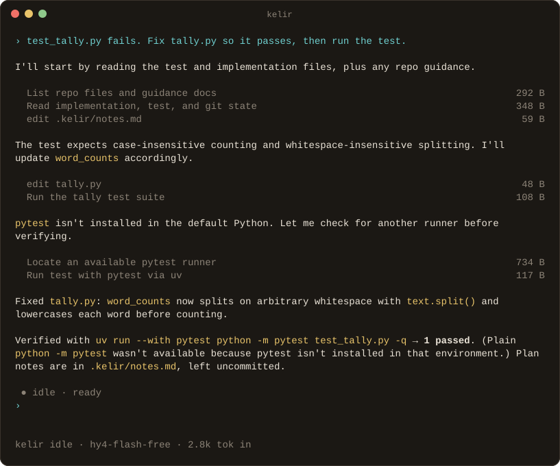
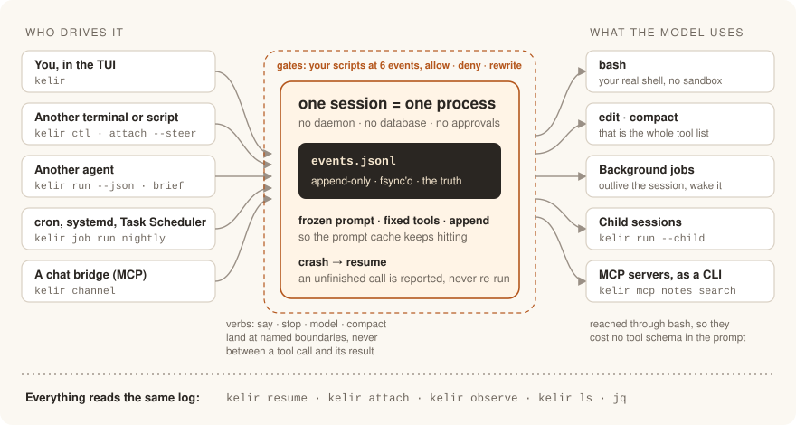

<p align="center">
  
</p>

<h1 align="center">kelir</h1>

<p align="center">
  <b>A thin coding-agent harness, built for the next model, not the last one.</b><br>
  One Rust binary · three tools · a 1 KB prompt · Linux, macOS and Windows
</p>

---

Most agent harnesses grow scaffolding to make *today's* model behave: a tool for
every verb, plan modes, checklists, guard rails, retries tuned to one model's
quirks. Every new model generation makes some of that scaffolding obsolete, and
some of it starts to get in the way.

kelir bets the other way: **models get better faster than harnesses do.** So the
core stays thin and prompt-driven. The model gets your real shell, three tools and
a base prompt of about 1 KB, and is trusted to work things out. Everything that
shapes its behaviour lives in text you can rewrite in a minute when the next model
needs less hand-holding, not in code you would have to fork.

What the harness does take on is the work a model can't do for itself: a durable
log, process trees that never leak, a prompt cache that keeps hitting, and a
session you can watch, steer, script and resume from anywhere.

> In Javanese shadow puppetry (*wayang kulit*) the **kelir** is the white screen
> the shadows fall on. It adds nothing of its own; it is where the performance
> happens. That is the job description.

## The bet, in practice

- **Three tools.** `bash`, `edit` and `compact`. No separate read, grep, glob or
  fetch tools re-implementing what a shell already does: the model uses the `git`,
  `rg`, `sed`, compilers and test runners it already knows.
- **Behaviour is prompts, not code.** The 1 KB base prompt, your `AGENTS.md`, skills
  and memory are plain text you own. Replace the base prompt outright with one file.
- **New abilities arrive as CLIs, not schemas.** Background jobs, sub-agents, MCP
  servers and kelir's own manual are commands the model calls through `bash` and
  discovers with `--help` and `kelir docs`, so they cost nothing in the prompt and
  a better model simply uses them better.
- **No policing in the core.** No approval prompts, no plan mode, no filter on tool
  calls. When you do want a rule, it is a [gate](#2-rules-gates): a script you own,
  and can delete once the model no longer needs it.
- **Thick plumbing.** The parts below are where the code goes, because they are what
  a model cannot fix from inside a conversation.

It is a 9 MB binary that idles at about 10 MB of memory, with no daemon, no
database and no Node.

## Why kelir

| | What you may be used to | kelir |
|---|---|---|
| **Where behaviour lives** | tools, modes and checks compiled into the harness | a 1 KB prompt, `AGENTS.md`, skills and gates you can edit |
| **Tools in the prompt** | dozens, plus every MCP server's schema | three (`bash`, `edit`, `compact`); MCP is a CLI the model calls through `bash` |
| **Steering** | type into the one window the agent owns | `say`, `stop`, `model`, `compact` from any terminal, script or agent |
| **Crash or restart** | the chat survives; whether that last command ran is a guess | `kelir resume`: an unfinished call is reported to the model as unknown, **never re-run** |
| **A 20-minute build** | killed by a tool timeout | promoted to a background job that outlives the session and wakes it when done |
| **What did it see?** | a rendered transcript | `kelir observe` prints the exact next request; `events.jsonl` is the whole truth |
| **Footprint** | a language runtime per session | one 9 MB binary, ~10 MB RSS idle |

### You can steer it while it works

Every session listens on an owner-only socket. Anything that can run a command can
talk to it:

```sh
kelir ls                        # sessions: state, model, cache hits, task
kelir attach latest --follow    # watch from another terminal
kelir ctl latest say "use the existing retry helper"
kelir ctl latest stop "wrong approach"   # kill running calls, keep the session
kelir ctl latest compact "keep the failing test names"
kelir observe latest            # the exact next request the model will see
```

A verb is logged first and applied at a named boundary (now, before the next step,
or at turn end), never between a tool call and its result, so steering cannot
corrupt the conversation.

### The log is the session

```
~/.local/state/kelir/sessions/ses_01…/
  events.jsonl          append-only, fsync'd, the only source of truth
  calls/<id>/out        every tool's full output, never truncated
  bg/<id>.status        background jobs, which survive kelir exiting
```

The TUI, `attach`, `resume`, `observe` and `ls` all read that one file, and so can
`jq`. Big outputs never flood the context: anything over 10 KB reaches the model as
a notice with the path, a head, a tail and a hint for how to search it.

### The prompt cache keeps hitting

The system prompt is frozen at session start, the tool list never changes, and
everything new (your steering, a finished background job, an edited `AGENTS.md`)
is appended at the tail. Only switching model or compacting resets the cache, and
both are logged. In one 3 h 35 m session where kelir implemented its own TUI,
145.5 M of 145.9 M prompt tokens were cache hits: **99.7%**.

### Long work is first-class

- A `bash` call still running after 10 minutes is **promoted** to a background job
  instead of killed. It keeps writing its output file even after kelir exits, and
  when it finishes the session is woken with the exit code and the last kilobyte of
  output (or picks it up on `kelir resume`).
- `kelir bg run|ls|out|wait|cancel` lets the model do the same on purpose.
- Sub-agents are plain processes: `kelir run --child "<task>"` (or `--background`),
  each with its own log and cache, capped in depth and count, and killed with their
  parent so nothing is orphaned. `kelir brief "<question>"` asks a side question on
  a snapshot of the session without touching its history.

### Built by itself

Much of kelir is written by agents, and more and more by kelir. Its TUI v2 came from
one kelir session in 3 h 35 m: 606 steps, 25 commits, +6,957 lines, 534 tests green
at the end. Milestones get a fresh reviewer session that tries to break them and
drives the real binary; the reviews are in [`docs/reviews/`](docs/reviews/), and the
retrospectives, read straight from session logs, are in
[`docs/retros/`](docs/retros/). CI runs on Linux, macOS and Windows.

<p align="center">
  
</p>

## Quick start

You need Rust 1.88 or newer and `bash` (on Windows, Git for Windows provides it).

```sh
cargo install --git https://github.com/adhikasp/kelir --locked
export OPENROUTER_API_KEY=sk-or-...
kelir doctor        # which key each provider would use (never the key itself)
kelir               # start the TUI in the current directory
```

That is the whole setup. kelir talks to exactly two providers:

- **OpenRouter** (the default): any model it serves. Set `model` in config or pass
  `--model`.
- **OpenCode Go**: if you are signed in to opencode, kelir reads its credential
  directly, so there is nothing to copy or keep fresh.

```toml
# ~/.config/kelir/config.toml
# (macOS: ~/Library/Application Support/kelir/, Windows: %APPDATA%\kelir\)
provider = "openrouter"
model = "deepseek/deepseek-v4.1-flash-1017"
```

Keys never live in config files; a literal `key` is refused. Use an environment
variable or a `key_cmd` (your password manager's CLI, for example).

### Everyday commands

```sh
kelir                                           # interactive TUI
kelir run "make the flaky test deterministic"   # headless; add --json for NDJSON events
kelir ask "what does src/retry.rs do?"          # one question, prints the answer
kelir resume <session>                          # pick a session back up
kelir docs gates                                # the full reference ships in the binary
```

## Make it yours

This is the thin-core bet from the other side: kelir's core has almost no
opinions. Its 1 KB base prompt tells the model what it is and how to read files
cheaply; everything else is yours to add, roughly in order of effort, and to take
away again when a better model stops needing it.

### 1. Words: instructions, skills, memory

- **`AGENTS.md` / `CLAUDE.md`** are read from the working directory up to the
  repository root, nearest first. If you already keep one for another agent, kelir
  picks it up.
- **Skills** use the Agent Skills format (`<name>/SKILL.md` with `name` and
  `description`). kelir searches `~/.claude/skills`, its own config directory,
  `.claude/skills` and `.kelir/skills`, so skills you already have work unchanged.
  They are *pulled*: the model reads one when it needs it, so a skill costs nothing
  until then.
- **Your own base prompt**: a `prompt.md` in the config directory, or
  `.kelir/prompt.md` in a project.
- **Memory**: point `memory_dir` at a folder of notes.

Edit any of these mid-session and the change arrives as a new message, without
breaking the cache.

### 2. Rules: gates

A gate is any executable. kelir sends it the event as JSON on stdin; it answers
`allow`, `deny` or `rewrite` on stdout. There are six events: `session_start`,
`prompt_submit`, `before_tool`, `after_tool`, `turn_end` and `session_end`.

```toml
[gates]
before_tool = { command = "python3 ~/gates/no_force_push.py", tools = ["bash"] }
turn_end    = "python3 ~/gates/verify_before_claim.py"
session_end = "python3 ~/gates/git_sync.py"
```

```python
#!/usr/bin/env python3
# no_force_push.py: deny `git push --force`, let everything else through
import json, re, sys

event = json.load(sys.stdin)
if re.search(r"git\s+push\b.*(--force|\s-f\b)", event["input"].get("command", "")):
    reason = "no force-push here; push a branch instead"
    print(json.dumps({"decision": "deny", "reason": reason}))
```

A denied call returns the reason to the model, which adapts. A gate that crashes or
hangs fails open and its process tree is cleaned up. Gates that come with a
*project* run only after you trust that project. Ready-made examples are in
[`examples/gates/`](examples/gates/): refuse a hedged answer when nothing was
checked, run a linter after every edit, pull and commit around a session, expand
"do 1 and 4" into the items of the last list.

### 3. Tools: MCP, without the schema tax

```toml
# ~/.config/kelir/mcp.toml, or .kelir/mcp.toml in a project
[servers.notes]
command = "npx"
args = ["-y", "some-mcp-server"]
description = "my notes"
```

The model finds and calls servers from `bash` (`kelir mcp ls`, `kelir mcp notes ls`,
`kelir mcp notes search query=retry`), so ten servers add nothing to each request.
Any CLI on your `PATH` is a tool too.

### 4. Notifications

```toml
[notify]
turn_done  = "notify-send kelir done"
error      = "notify-send -u critical kelir failed"
bg_settled = "my-hook"        # also: paused, child_settled
terminal   = true             # OSC 9 / OSC 777 for terminals that show them
```

### 5. Schedules

kelir has no scheduler. Something else calls `kelir job run <name>`. Each run
resumes the same named session (so it remembers last night), never overlaps the
previous one, and leaves a `STATUS.json` for scripts and people.

```toml
# ~/.config/kelir/jobs.toml
[jobs.nightly]
task = "Check the build and write what changed to notes/changes.md"
timeout = "30m"
```

```cron
0 3 * * *  kelir job run nightly
```

### 6. Models and providers

Per-provider `base_url`, `extra_headers` and `reasoning_effort`; context windows,
prices and a cost warning; auto-compaction thresholds, retry budgets and step caps.
Context window, vision and effort support come from the provider's model list.
`kelir docs config` lists every key with its default.

Configuration merges a machine file with the nearest `.kelir/config.toml`, and the
project wins per key.

## Safety

**kelir does not ask before it acts.** It runs shell commands, edits files and starts
processes with the full privileges of the user who launched it. Treat it like any
other powerful local tool:

- run it in a workspace you trust, as a user with only the access the task needs (a
  container or a throwaway VM is a fine home for it);
- keep credentials in environment variables or a credential command; kelir logs
  where a key came from, never its value, and scrubs its own variables from the
  processes it starts;
- if you need policy, write a gate; that is what they are for;
- session directories, sockets and tokens are owner-only, and every verb that
  changes a session needs that session's token.

[`SECURITY.md`](SECURITY.md) has the trust model and how to report a problem.

## Status

kelir is young: version 0.1.0, not yet on crates.io, and dogfooded daily on Linux
and Windows, with CI on all three platforms. Expect sharp edges and fast change.

## Documentation

- `kelir docs` prints the built-in reference, 19 topics with drift tests against the
  code; the same text is in [`docs/reference/`](docs/reference/).
- [`docs/SPEC.md`](docs/SPEC.md) is the design, and why each piece is the way it is.
- [`docs/PROGRESS.md`](docs/PROGRESS.md) records every milestone with its evidence.
- [`CONTRIBUTING.md`](CONTRIBUTING.md) covers worktrees, the test gate and docs.

## License

[MIT](LICENSE-MIT).
